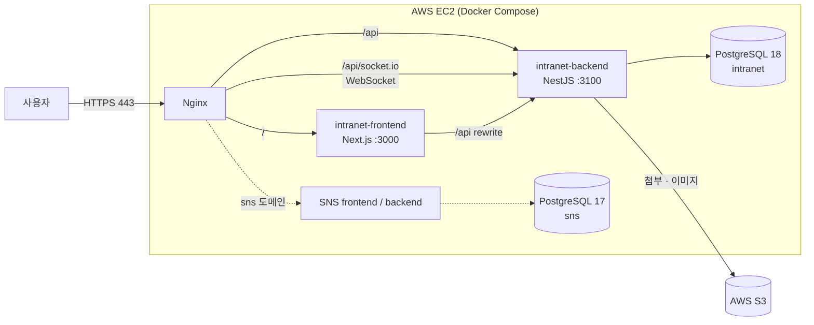
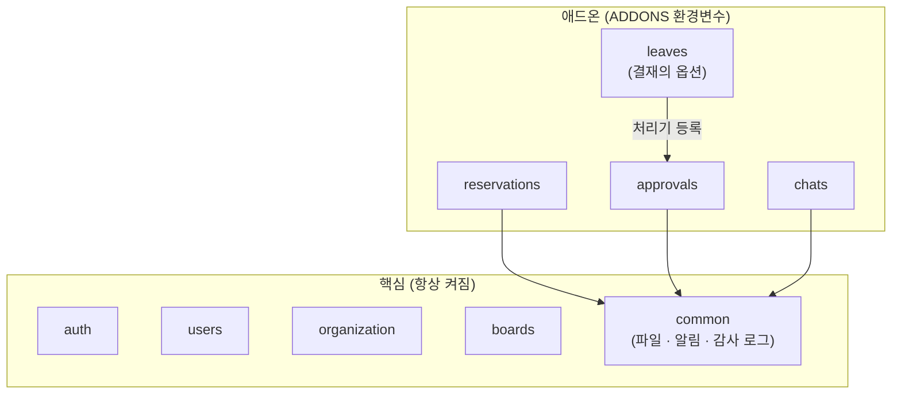

# 기업 인트라넷 (Intranet)

> 게시판·시설 예약·전자결재·휴가·채팅을 갖춘 기업 인트라넷 웹 시스템
> NestJS + Next.js + PostgreSQL + Prisma, AWS EC2에 Docker Compose로 배포 (작업 예정)

<!-- TODO: 배포 후 실제 값으로 교체 -->
<!-- 
- **서비스 주소**: https://demo.example.com
- **시연 영상**: (링크)
- **포트폴리오 (Notion)**: (링크)
- **체험 계정**: 관리자 `사번 / 비밀번호`, 일반 사용자 `사번 / 비밀번호`
-->

<!-- TODO: 메인 화면 스크린샷 -->

---

## 프로젝트 소개

PHP 백엔드 개발 경험을 바탕으로 **TypeScript 풀스택**(NestJS · Next.js)으로 만든 사내 인트라넷입니다.

목표는 기능 개수가 아니라 다음 세 가지입니다.

- **설명할 수 있는 구조**: 모듈 경계, 의존 방향, 권한 검사 위치를 문서로 남기고 그대로 구현
- **실제로 동작하는 기능**: 동시 요청(중복 예약, 동시 승인)을 e2e 테스트로 확인
- **배포 가능한 결과물**: 기존 SNS 프로젝트와 같은 EC2 서버에 함께 운영 (작업 예정)

| 항목 | 내용 |
|---|---|
| 기간 | 2026.10 ~ 2026.12 |
| 인원 | 1인 개발 |

### 개발 방식

- **직접 구현**: 인증 · 회원 · 조직 · 게시판 등 핵심 모듈의 기본 구조 (2026.10)
- **설계 후 AI 도구로 구현**: 애드온(시설 예약 · 전자결재 · 휴가 · 채팅), 핵심 보강(파일 · 알림 · 감사 로그 · 관리자 권한), 프론트엔드
  - 요구사항 · DB 스키마 · API 계약 · 동시성 처리 방식은 직접 정하고, 구현된 코드는 검토 · 수정 후 e2e 테스트로 검증

---

## 기술 스택

| 구분 | 기술 |
|---|---|
| Backend | NestJS 11, TypeScript, Prisma 7, Socket.IO, class-validator, sanitize-html, sharp |
| Frontend | Next.js 16 (App Router), React 19, TanStack Query, Tailwind CSS 4, shadcn/ui, Tiptap |
| Database | PostgreSQL 18 |
| Test | Jest, Supertest (e2e는 별도 테스트 DB) |
| Infra | Docker / Docker Compose, Nginx, AWS EC2 (t4g.medium, arm64), AWS S3 |

---

## 주요 기능

### 핵심 기능

| 기능 | 설명 |
|---|---|
| 회원 · 인증 | 가입 후 관리자 승인, Access Token(메모리) + Refresh Token(HttpOnly 쿠키), 기기별 로그인 세션 관리, 로그인 실패 단계 잠금 |
| 조직 | 부서(트리) · 직급 · 직책, 겸직(소속 여러 개), 드래그 정렬 |
| 관리자 | 슈퍼관리자가 관리자별 기능(회원 · 조직 · 게시판 · 시설 · 예약 · 결재라인 · 연차) 지정, 회원 승인 · 권한 · 상태 변경(단건 · 일괄), 비밀번호 초기화, 잠금 해제 |
| 게시판 | 일반 · 공지 · 캘린더 · 앨범 게시판, 부서 · 직급 · 직책 조건의 게시판 권한, Tiptap 에디터, 첨부파일, 댓글 트리 |
| 알림 · 감사 로그 | 결재 요청 · 예약 변경 등 알림, 모든 데이터 변경 이력(감사 로그) |

### 애드온 (배포 설정으로 켜고 끔)

| 기능 | 설명 |
|---|---|
| 시설 예약 | 회의실 · 차량 · 장비 예약, 시간표(하루 · 주간), 반복 예약, 분류별 운영 시간 · 예약 단위 |
| 전자결재 | 결재라인(순차 + 병렬 단계), 임시저장 · 상신 · 회수 · 반려 · 다시 기안, 결재함 6종 |
| 휴가 | 결재의 옵션. 연차 · 병가 · 공가를 종일 · 반차 · 반반차로 신청(전자결재 문서 유형 "휴가"로 상신), 남은 연차(결재 중 포함) · 신청 이력, 근속 기준 연차 자동 계산(매월 재계산) + 관리자 조정(매년 · 영구), 캘린더 게시판에 승인된 휴가자 표시 |
| 채팅 | 1:1 · 그룹 채팅방(초대 · 내보내기 · 방장 위임 · 방 이름), Socket.IO 실시간 받기, 메시지별 안 읽은 사람 수 · 방별 안 읽은 수 배지, 메시지 수정 · 삭제(5분 이내, 수정 이력 보관), 파일 · 이미지 묶음 전송(비공개 미리보기) · 파일 보관함, 페이지를 옮겨도 유지되는 떠 있는 창 |

<!-- TODO: 기능별 GIF 또는 스크린샷 -->

---

## 아키텍처

### 운영 배포 구조 (작업 예정)



- 외부에는 Nginx(80/443)만 노출하고, 애플리케이션과 DB는 Docker 내부 네트워크로만 접근합니다. 보안 그룹은 22 / 80 / 443만 엽니다.
- Frontend와 Backend는 **별도 컨테이너**로 운영해 빌드 · 재배포 · 로그 · 장애 범위를 분리했습니다.
- 기존 SNS 프로젝트와 같은 서버를 쓰고, DB는 아래처럼 별도 `infra-db`로 관리합니다.

### DB 인프라 분리

DB는 애플리케이션 저장소와 분리해, 별도 `infra-db`(docker-compose)에서 기존 SNS 프로젝트와 같이 씁니다.

```text
infra-db
├── postgres17  → sns
└── postgres18  → intranet, intranet_test (e2e 전용)
```

- PostgreSQL 메이저 버전이 달라 버전별 컨테이너로 나누고, DB마다 전용 계정만 접속하게 격리했습니다. 포트는 `127.0.0.1`에만 바인딩합니다.

### 백엔드 모듈 구조: 핵심 + 애드온



- `backend/.env`의 `ADDONS=reservations,approvals,leaves,chats`로 애드온 모듈을 등록할지 정합니다. 꺼진 애드온은 **API 자체가 없고(404)**, 프론트는 `GET /common/addons` 응답으로 메뉴를 숨깁니다.
- **의존 방향**: 애드온 → 핵심은 허용, 핵심 → 애드온은 금지. 결재 본체는 휴가 모듈을 import하지 않고, 휴가가 결재에 **문서 유형별 처리기**를 등록합니다.
- 설정이 잘못되면(결재를 끄고 휴가만 켬) 서버가 시작 단계에서 멈춥니다.

---

## 기술적 의사결정 & 트러블슈팅

### 1. 시설 예약 시간 중복 방지 (동시 요청)

- 조회 후 저장 사이의 경쟁 상태를 **트랜잭션 검사 + PostgreSQL exclusion constraint**로 이중 방어
- 같은 시간 동시 요청 10건 → 1건 성공, 9건 409 (e2e)

### 2. 전자결재 동시 승인

- 동시 승인이나 회수 · 승인이 겹쳐도 상태가 꼬이지 않도록, 모든 상태 변경이 **문서 행 조건부 UPDATE**를 먼저 하게 통일
- 동시 승인 5건 → 1건만 성공, 회수와 승인 동시 요청 → 한쪽만 성공 (e2e)

### 3. 결재와 휴가 분리 + 한 트랜잭션 처리

- 결재 본체는 휴가를 모르고, 휴가 모듈이 **문서 유형별 처리기**를 등록해 상신 · 최종 승인 트랜잭션 안에서 연차를 검사 (실패하면 전체 롤백)
- 남은 연차 3일인 회원이 2일짜리 두 건을 동시에 상신 → 1건만 성공 (e2e)

### 4. JWT 인증과 기기별 세션

- Access Token은 stateless(가드가 DB를 조회하지 않음), Refresh Token은 기기별 세션 + rotation + 재사용 감지
- 기기 하나 로그아웃과 모든 기기 로그아웃의 처리 수단을 나눔

### 5. 채팅: 보내기는 REST, 소켓은 받기만

- 이전 SNS 프로젝트의 소켓 전송 · 클라이언트 방 관리 방식에서 생긴 문제(나간 사람이 계속 받음, 전송 성공 여부를 모름)를 개선
- 보내기 · 수정 · 삭제는 **REST**로 기존 가드 · 검증 · 트랜잭션을 그대로 쓰고, 소켓은 **커밋 후 서버 푸시** 전용. 받는 사람은 매번 DB의 활성 참여자로 정함
- 소켓 연결은 access token 만료 시각에 서버가 끊고, 클라이언트가 새 토큰으로 다시 연결

### 그 밖의 결정

- **게시판 권한**: 규칙이 없는 게시판은 관리자만 보는 기본 거부, 부서 · 직급 · 직책 조건 조합
- **기능별 관리자 권한**: 슈퍼관리자가 관리자별 담당 기능을 지정, 마지막 슈퍼관리자는 강등 · 삭제 불가
- **결재라인 스냅샷**: 상신할 때 결재자 정보를 문서에 복사해 인사 이동 후에도 결재 당시 기록 유지
- **본문 HTML 정제**: 에디터 HTML을 백엔드에서 허용 태그만 남기고 저장
- **파일 저장소 추상화**: 추상 클래스 뒤에 로컬 / S3 구현체를 두어 서비스 코드 변경 없이 교체

---

## 프로젝트 구조

```text
intranet/
├── backend/                  # NestJS
│   ├── src/
│   │   ├── auth/             # 로그인 · 토큰 · 기기 세션
│   │   ├── users/
│   │   ├── organization/     # 부서 · 직급 · 직책 · 소속
│   │   ├── boards/           # 게시판 · 권한 · 게시글 · 댓글
│   │   ├── reservations/     # 애드온: 시설 예약
│   │   ├── approvals/        # 애드온: 전자결재 (+ leaves/ 휴가 옵션)
│   │   ├── chats/            # 애드온: 채팅 (REST + Socket.IO 푸시, 파일 메시지)
│   │   ├── common/           # 파일 · 알림 · 감사 로그 · 공용 유틸
│   │   └── config/           # 애드온 설정 등
│   ├── prisma/               # schema.prisma, migrations, seed
│   └── test/                 # e2e 테스트
├── frontend/                 # Next.js (App Router)
│   └── src/
│       ├── app/              # (auth) · (main) · admin 라우트
│       ├── features/         # 기능별 화면 · 훅
│       └── services/api/     # 백엔드 컨트롤러와 1:1 대응하는 API 함수
```

---

## 로컬 실행

### 준비

- Node.js, PostgreSQL 18 (위 `infra-db` 구성 또는 Docker 컨테이너) <!-- TODO: Node.js 버전, infra-db 저장소 링크 -->


### Backend

```bash
cd backend
cp .env.example .env          # DATABASE_URL, JWT_SECRET, ADDONS 등 설정
npm install
npx prisma migrate deploy
npx prisma db seed            # 기본 데이터 + 테스트 계정
npx tsx prisma/seed-super-admin.ts <사번>   # 첫 슈퍼관리자 지정 (이후 관리자 지정은 화면에서)
npm run start:dev             # http://localhost:3100
```

### Frontend

```bash
cd frontend
cp .env.example .env          # API_SERVER_URL=http://localhost:3100
npm install
npm run dev                   # http://localhost:3000
```

### 테스트

```bash
cd backend
npm test                      # 단위 테스트
npm run test:e2e              # e2e (.env.test.example을 복사한 .env.test의 별도 테스트 DB 사용)
```

---

## 회고 · 개선 계획

<!-- TODO: 완료 후 작성 -->
- 비밀번호 재설정을 관리자 임시 비밀번호 발급에서 메일(AWS SES) 방식으로 전환
- 과제 관리 애드온(프로젝트 · 칸반 · 진척도)
- 실시간 알림(Socket.IO)
