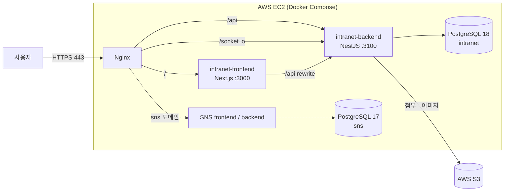
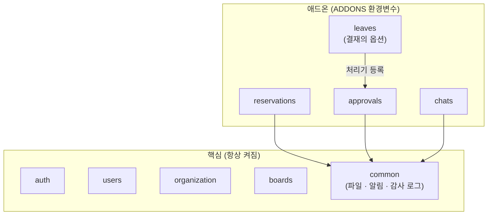

# 기업 인트라넷 (Intranet)

> 게시판·시설 예약·전자결재·휴가·채팅을 갖춘 기업 인트라넷 웹 시스템
> NestJS + Next.js + PostgreSQL + Prisma, AWS EC2에 Docker Compose로 배포 (작업 예정)

<!-- TODO: 배포 후 실제 값으로 교체 -->
<!-- 
- **서비스 주소**: https://demo.example.com
- **시연 영상**: (링크)
- **포트폴리오 (Notion)**: (링크)
- **체험 계정**: 관리자 `사번 / 비밀번호`, 일반 사용자 `사번 / 비밀번호`
-->

<!-- TODO: 메인 화면 스크린샷 -->

---

## 프로젝트 소개

PHP 백엔드 개발 경험을 바탕으로 **TypeScript 풀스택**(NestJS · Next.js)으로 만든 사내 인트라넷입니다.

목표는 기능 개수가 아니라 다음 세 가지입니다.

- **설명할 수 있는 구조**: 모듈 경계, 의존 방향, 권한 검사 위치를 문서로 남기고 그대로 구현
- **실제로 동작하는 기능**: 동시 요청(중복 예약, 동시 승인)을 e2e 테스트로 확인
- **배포 가능한 결과물**: 기존 SNS 프로젝트와 같은 EC2 서버에 함께 운영 (작업 예정)

| 항목 | 내용 |
|---|---|
| 기간 | 2026.10 ~ 2026.12 |
| 인원 | 1인 (설계·백엔드·배포 직접, 프론트엔드는 AI 도구로 구현 후 검토) |

---

## 기술 스택

| 구분 | 기술 |
|---|---|
| Backend | NestJS 11, TypeScript, Prisma 7, Socket.IO, class-validator, sanitize-html, sharp |
| Frontend | Next.js 16 (App Router), React 19, TanStack Query, Tailwind CSS 4, shadcn/ui, Tiptap |
| Database | PostgreSQL 18 |
| Test | Jest, Supertest (e2e는 별도 테스트 DB) |
| Infra | Docker / Docker Compose, Nginx, AWS EC2 (t4g.medium, arm64), AWS S3 |

---

## 주요 기능

### 핵심 기능

| 기능 | 설명 |
|---|---|
| 회원 · 인증 | 가입 후 관리자 승인, Access Token(메모리) + Refresh Token(HttpOnly 쿠키), 기기별 로그인 세션 관리, 로그인 실패 단계 잠금 |
| 조직 | 부서(트리) · 직급 · 직책, 겸직(소속 여러 개), 드래그 정렬 |
| 관리자 | 회원 승인 · 권한 · 상태 변경(단건 · 일괄), 비밀번호 초기화, 잠금 해제 |
| 게시판 | 일반 · 공지 · 캘린더 · 앨범 게시판, 부서 · 직급 · 직책 조건의 게시판 권한, Tiptap 에디터, 첨부파일, 댓글 트리 |
| 알림 · 감사 로그 | 결재 요청 · 예약 변경 등 알림, 모든 데이터 변경 이력(감사 로그) |

### 애드온 (배포 설정으로 켜고 끔)

| 기능 | 설명 |
|---|---|
| 시설 예약 | 회의실 · 차량 · 장비 예약, 시간표(하루 · 주간), 반복 예약, 분류별 운영 시간 · 예약 단위 |
| 전자결재 | 결재라인(순차 + 병렬 단계), 임시저장 · 상신 · 회수 · 반려 · 다시 기안, 결재함 6종 |
| 휴가 (작업 예정) | 결재의 옵션. 연차 · 반차 · 반반차 신청 = 결재 상신, 최종 승인 시 잔여 연차 반영 |
| 채팅 (작업 예정) | 1:1 · 그룹 채팅방, Socket.IO 실시간 메시지, 안 읽은 메시지 수 |

<!-- TODO: 기능별 GIF 또는 스크린샷 -->

---

## 아키텍처

### 운영 배포 구조 (작업 예정)



- 외부에는 Nginx(80/443)만 노출하고, 애플리케이션과 DB는 Docker 내부 네트워크로만 접근합니다. 보안 그룹은 22 / 80 / 443만 엽니다.
- Frontend와 Backend는 **별도 컨테이너**로 운영해 빌드 · 재배포 · 로그 · 장애 범위를 분리했습니다.
- 기존 SNS 프로젝트와 같은 서버를 쓰고, DB는 아래처럼 별도 `infra-db`로 관리합니다.

### DB 인프라 분리

이 저장소는 세 프로젝트 중 하나입니다. DB는 애플리케이션 저장소에 두지 않고 별도 `infra-db`에서 두 프로젝트가 같이 씁니다.

```text
portfolio/
├── infra-db/      # SNS · Intranet 공용 PostgreSQL (docker-compose, DB · 계정 생성 스크립트)
├── NestJS_SNS/    # 기존 SNS 프로젝트 (PostgreSQL 17)
└── intranet/      # 이 저장소 (PostgreSQL 18)
```

```text
infra-db (docker-compose, network: infra-db-net)
├── postgres17  (127.0.0.1:5432)
│   └── sns            ← owner: sns_user
└── postgres18  (127.0.0.1:5433)
    ├── intranet       ← owner: intranet_user
    └── intranet_test  ← owner: intranet_test_user (e2e 테스트 전용)
```

- **메이저 버전별 인스턴스 분리**: 한 PostgreSQL 인스턴스(클러스터)에는 메이저 버전 하나만 올릴 수 있습니다. SNS는 기존 17을 유지하고 Intranet은 18을 쓰기 위해 컨테이너를 버전별로 나누고, docker-compose 하나로 함께 관리합니다.
- **프로젝트별 계정 격리**: DB마다 전용 계정을 owner로 두고 `REVOKE ALL ... FROM PUBLIC`으로 다른 계정의 접속을 막습니다. 애플리케이션은 슈퍼유저를 쓰지 않습니다.
- **외부 노출 차단**: 포트를 `127.0.0.1`에만 바인딩하고, 컨테이너끼리는 Docker 네트워크(`infra-postgres18:5432`)로 접근합니다.
- **애플리케이션과 생명주기 분리**: 앱을 다시 빌드하거나 배포해도 DB 컨테이너와 데이터는 그대로 남습니다. DB · 계정 생성 스크립트는 여러 번 실행해도 결과가 같게(멱등) 만들었습니다.
- **테스트 DB 분리**: e2e 테스트는 같은 인스턴스의 별도 DB `intranet_test`에서 실행합니다. 동시 요청 테스트는 실제 커밋이 필요해 트랜잭션 롤백 방식을 쓸 수 없어서, 테스트 시작 전에 테이블을 비웁니다.

### 백엔드 모듈 구조: 핵심 + 애드온



- `backend/.env`의 `ADDONS=reservations,approvals,leaves,chats`로 애드온 모듈을 등록할지 정합니다. 꺼진 애드온은 **API 자체가 없고(404)**, 프론트는 `GET /common/addons` 응답으로 메뉴를 숨깁니다.
- **의존 방향**: 애드온 → 핵심은 허용, 핵심 → 애드온은 금지. 결재 본체는 휴가 모듈을 import하지 않고, 휴가가 결재에 **문서 유형별 처리기**를 등록합니다.
- 설정이 잘못되면(결재를 끄고 휴가만 켬) 서버가 시작 단계에서 멈춥니다.

---

## 기술적 의사결정 & 트러블슈팅

### 1. 시설 예약 시간 중복 방지 (동시 요청)

- **문제**: "겹치는 예약이 있는지 조회 → 없으면 저장"만으로는 두 요청이 동시에 "없음"을 확인하고 둘 다 저장할 수 있습니다(검사와 저장 사이 경쟁 상태).
- **해결**: 이중 방어
  1. 트랜잭션 안에서 겹침 조회 → 사용자에게 보여 줄 409 메시지
  2. PostgreSQL **exclusion constraint**(`tsrange(start_at, end_at, '[)') WITH &&`)를 최종 방어선으로 두고, 위반 오류(23P01)를 409로 변환
- **선택하지 않은 것**: 시설 행 잠금(`SELECT ... FOR UPDATE`). DB 제약만으로 결과가 같고, 잠금은 같은 시설의 다른 시간대 예약까지 줄 세웁니다.
- **결과**: 같은 시간에 10건을 동시에 요청하면 1건만 성공하고 9건은 409 (e2e 테스트)

### 2. 전자결재 상태 전이와 동시 승인

- **문제**: 같은 단계 결재자 두 명의 동시 승인, 기안자 회수와 결재자 승인이 겹치는 경우 상태가 꼬이거나 교착(deadlock)이 생길 수 있습니다.
- **해결**: 모든 상태 변경이 **문서 행 조건부 UPDATE**(`WHERE status = 기대 상태 AND currentStepOrder = 기대 순서`)를 먼저 하도록 잠금 순서를 통일했습니다. 뒤에 온 요청은 앞 트랜잭션이 끝난 뒤 0행이 되어 409를 받습니다.
- **결과**: 동시 승인 5건 → 1건만 성공, 회수와 승인 동시 요청 → 한쪽만 성공, 병렬 단계 동시 승인 → 다음 단계가 한 번만 열림 (각 5회 반복 e2e)

### 3. 결재 최종 승인과 연차 반영을 한 트랜잭션으로 (작업 예정)

- **문제**: 결재는 공통 승인 기능이고 휴가는 업무 데이터입니다. 결재가 휴가를 직접 호출하면 결재가 휴가에 묶이고, 따로 처리하면 "승인됐는데 연차가 안 빠진" 상태가 생길 수 있습니다.
- **해결**: 휴가 모듈이 시작할 때 결재에 처리기(`onSubmit`, `onFinalApproved`)를 등록하고, 결재는 최종 승인 트랜잭션의 `tx`를 그대로 넘겨 호출합니다. 처리기에서 예외가 나면 승인 전체가 롤백됩니다.
- **결과**: 결재 본체는 휴가를 모르고, 휴가 옵션을 끄면 처리기가 등록되지 않아 휴가 문서 유형만 사라집니다.

### 4. 결재라인 스냅샷

- 결재라인 템플릿은 불러오기 용도이고, 상신할 때 결재자 이름 · 부서 · 직급 · 직책을 문서 단계에 **복사**합니다. 이후 인사 이동이나 템플릿 변경이 있어도 결재 당시 기록이 그대로 남습니다.

### 5. JWT 인증과 기기별 세션

- **Access Token(10분)은 stateless**: 가드는 payload만 검증하고 DB를 조회하지 않습니다.
- **Refresh Token은 stateful**: 로그인마다 세션 행을 만들고 재발급마다 교체(rotation)하며, 이미 쓴 토큰이 다시 오면 탈취로 보고 세션을 폐기합니다.
- **시행착오**: 처음에는 로그아웃 시 `tokenVersion`을 올렸는데, 한 기기 로그아웃이 모든 기기를 끊었습니다. → 기기 하나는 세션 폐기, 모든 기기(비밀번호 변경 등)는 `tokenVersion`으로 수단을 나눴습니다.
- **다중 탭 문제**: 탭 두 개가 거의 동시에 재발급하면 정상 사용자가 탈취로 오판되어 로그아웃됐습니다. → 교체 직후 1분 동안 직전 토큰을 허용하는 유예 시간을 두었습니다.

### 6. 채팅: 소켓 연결 인증 (작업 예정)

- HTTP 가드는 소켓 이벤트에 적용되지 않으므로, **handshake에서 JWT를 검증하고 `tokenVersion` · 재직 상태까지 확인**합니다. (빠지면 퇴사자가 채팅을 계속 볼 수 있습니다.)
- 채팅방 생성 · 이전 메시지 조회는 REST, 실시간 송수신은 Socket.IO로 역할을 나눴고, 메시지는 **DB 저장 후 emit**합니다.
- 서버가 여러 대가 되면 Redis adapter로 인스턴스 간 이벤트를 공유해야 하지만, 현재는 단일 서버라 도입하지 않았습니다.

### 그 밖의 결정

- **게시판 권한**: 규칙이 없는 게시판은 관리자만 보는 기본 거부, 부서(하위 부서 포함) · 최소 직급 · 직책 조건 조합
- **본문 HTML 정제**: 에디터 HTML을 백엔드에서 허용 태그만 남기고 저장, 영상은 YouTube · Vimeo 임베드만 허용
- **파일 저장소 추상화**: `FileStorage` 추상 클래스 뒤에 로컬 / S3 구현체를 두어 서비스 코드 변경 없이 저장 위치를 교체
- **알림은 커밋 후 best effort**: 알림 실패가 업무 처리를 되돌리지 않도록 트랜잭션 밖에서 호출, 감사 로그는 같은 트랜잭션
- **일괄 처리 경쟁 상태**: 검증 조건을 `updateMany`의 WHERE에 다시 걸고, 바뀐 행 수가 요청 수와 다르면 전체 롤백
- **한글 정렬**: DB 기본 collation이 한글을 가나다순으로 정렬하지 않아 이름 컬럼을 `ko-x-icu`로 변경

---

## 프로젝트 구조

```text
intranet/
├── backend/                  # NestJS
│   ├── src/
│   │   ├── auth/             # 로그인 · 토큰 · 기기 세션
│   │   ├── users/
│   │   ├── organization/     # 부서 · 직급 · 직책 · 소속
│   │   ├── boards/           # 게시판 · 권한 · 게시글 · 댓글
│   │   ├── reservations/     # 애드온: 시설 예약
│   │   ├── approvals/        # 애드온: 전자결재 (+ leaves/ 휴가 옵션, 작업 예정)
│   │   ├── chats/            # 애드온: 채팅 (작업 예정)
│   │   ├── common/           # 파일 · 알림 · 감사 로그 · 공용 유틸
│   │   └── config/           # 애드온 설정 등
│   ├── prisma/               # schema.prisma, migrations, seed
│   └── test/                 # e2e 테스트
├── frontend/                 # Next.js (App Router)
│   └── src/
│       ├── app/              # (auth) · (main) · admin 라우트
│       ├── features/         # 기능별 화면 · 훅
│       └── services/api/     # 백엔드 컨트롤러와 1:1 대응하는 API 함수
└── docs/                     # 설계 · 기능별 구조 문서
```

---

## 로컬 실행

### 준비

- Node.js, PostgreSQL 18 (위 `infra-db` 구성 또는 Docker 컨테이너) <!-- TODO: Node.js 버전, infra-db 저장소 링크 -->


### Backend

```bash
cd backend
cp .env.example .env          # DATABASE_URL, JWT_SECRET, ADDONS 등 설정
npm install
npx prisma migrate deploy
npx prisma db seed            # 기본 데이터 + 테스트 계정
npm run start:dev             # http://localhost:3100
```

### Frontend

```bash
cd frontend
cp .env.example .env          # API_SERVER_URL=http://localhost:3100
npm install
npm run dev                   # http://localhost:3000
```

### 테스트

```bash
cd backend
npm test                      # 단위 테스트
npm run test:e2e              # e2e (.env.test의 별도 테스트 DB 사용)
```

---

## 문서

| 문서 | 내용 |
|---|---|
| [AGENTS.md](AGENTS.md) | 전체 설계 기준 (모듈 구조, 의존 방향, 공통 규칙) |
| [docs/design/features.md](docs/design/features.md) | 기능별 상세 규칙 |
| [docs/backend/](docs/backend/) | 인증 · 파일 · 알림 · 시설 예약 · 전자결재 백엔드 구조 |
| [docs/frontend/](docs/frontend/) | 화면별 구조 |
| [docs/design/deploy.md](docs/design/deploy.md) | 운영 배포 구성 |

---

## 회고 · 개선 계획

<!-- TODO: 완료 후 작성 -->
- 비밀번호 재설정을 관리자 임시 비밀번호 발급에서 메일(AWS SES) 방식으로 전환
- 과제 관리 애드온(프로젝트 · 칸반 · 진척도)
- 실시간 알림(Socket.IO)
